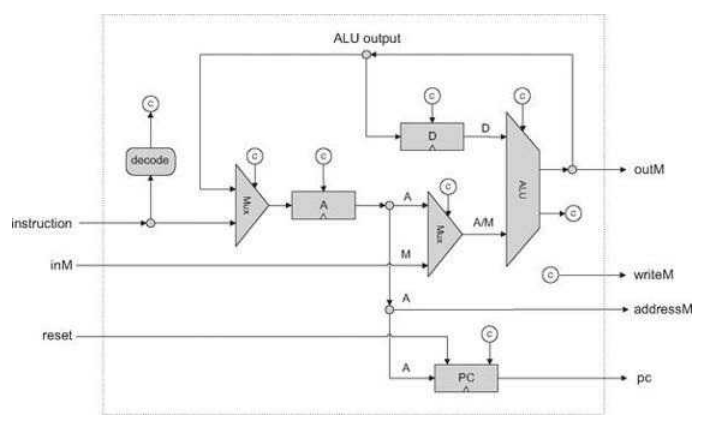
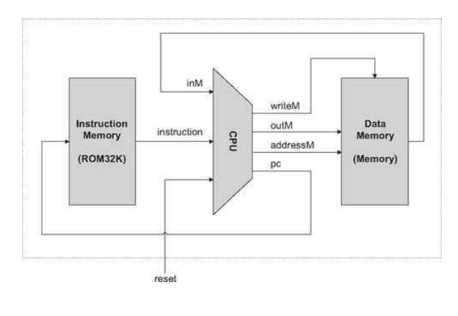

### Computer Architecture

The Hack Computer Architecture is based on the Von Neumann architecture.

```
+------------------+          +-----------------------------------+         +--------+
|     Memory       | <------> |                CPU                | <-----> | Input  |
| (data + instr.)  |          | +-------------------------------+ |         +--------+
|                  |          | |  Arithmetic Logic Unit (ALU)  | |
|                  |          | +-------------------------------+ |
|                  |          | |          Registers            | |
|                  |          | +-------------------------------+ |
|                  |          | |           Control             | |
+------------------+          +-------------------------------+---+
                                                    |
                                                    v
                                                +--------+
                                                | Output |
                                                +--------+
```

#### Memory


The memory of the Von Neumann machine holds two information:
- data.
- programming instructions.

Both types of information are represented as binary numbers that are stored in the same generic random-access structure: a continuous array of cells of some fixed width, also called words or locations, each having a unique address. Hence, an individual word (representing either a data item or an instruction) is specified by supplying its address.

The data memory holds binary data representing high level abstractions such as variables, arrays, objects etc.

The instruction memory holds instead the instructions written in the programming language of choice for the said program. The CPU in each step fetches a word from the instruction memory, decodes it and executes the specified instruction, figuring out what to execute next.

#### CPU

The CPU is in charge of executing the instructions of the currently loaded program. These instructions tell the CPU to carry out various calculations, to read and write values from and into the memory, and to conditionally jump to execute other instructions in the program. 
It is composed by:

- ALU
- Registers
- Control Unit
    - A computer instruction represented as a binary code, typically 16, 32, or 64 bits wide.
    - Before executing is decoded and used to signal various hardware devices (ALU, registers, memory) how to execute the instruction. 
    - The instruction decoding done by control unit.
    - Also responsible for figuring out which instruction to fetch and execute next.


The CPU operation can now be described as a repeated loop: fetch an instruction (word) from memory; decode it; execute it, fetch the next instruction, and so on. The instruction execution may involve one or more of the following micro tasks: have the ALU compute some value, manipulate internal registers, read
a word from the memory, and write a word to the memory. In the process of executing these tasks, the CPU also figures out which instruction to fetch and execute next.

#### Registers

Much faster access than to memory.

- Phisically closer to CPU.
- Much less in number: machine language instructions can specify registers with few bits.

Type of registers:
- Data registers.
- Addressing registers.
- Program counter registers.

#### Input/Output

Based on memory-mapped I/O.
The basic idea is to create a binary emulation of the I/O device, making it “look” to the CPU like a normal memory segment. In particular, each I/O device is allocated an exclusive area in memory, becoming its "memory map".
- Input device (e.g keyboard): Press the key, value is written in associated memory map.
- Output device (e.g screen): Want to color a pixel: value is written in associated memory map.

From the hardware point of view, this scheme requires each I/O device to provide an interface similar to that of a memory unit. From a software point of view, each I/O device is required to define an interaction contract, so that programs can access it correctly.

Whenever we want to connect a new I/O device to the computer, all we have to do is allocate to it a new memory map and take note of its base address.


### Hack Computer Architecture

The Hack platform is a 16-bit von Neumann machine, consisting of a CPU, two separate memory modules serving as instruction memory and data memory, and two memory-mapped I/O devices: a screen and a keyboard.

The Hack computer executes programs that reside in its instruction memory. The instruction memory is a read-only device, and thus programs are loaded into it using some exogenous means, in our case, loading a text file containing the hack program and creating a ROM chip from it with pre-burned the program itsel. As said the instruction memory is implemented in a ROM chip that is preburned with the required program.

The Hack CPU consists of the ALU and three registers called data register (D), address register (A), and program counter (PC). D and A are general-purpose 16-bit registers that can be manipulated by arithmetic and logical instructions. While the D-register is used solely to store data values, the contents of the A-register can be interpreted in three different ways, depending on the instruction’s context: as a data value, as a RAM address, or as a ROM address.

The computer architecture is wired in such a way that the output of the program counter (PC) chip is connected to the address input of the ROM chip. This way, the ROM chip always emits the word ROM[PC], namely, the contents of the instruction memory location whose address is "pointed at" by the PC. This value is called the current instruction.

The overall functioning of the Hack machine is in these two operations:

- Execute: Various bit parts of the current instruction are simultaneously fed to various chips in the computer. If it’s an address instruction (most significant bit = 0), the A-register is set to the 15-bit constant embedded in the instruction. If it’s a compute instruction (MSB = 1), its underlying a-, c-, d- and j-bits are treated as control bits that cause the ALU and the registers to execute the instruction.

- Fetch: Which instruction to fetch next is determined by the jump bits of the current instruction and by the ALU output. Taken together, these values determine whether a jump should materialize. If so, the PC is set to the value of the A-register; otherwise, the PC is incremented by 1. In the next clock cycle, the instruction that the program counter points at emerges from the ROM’s output, and the cycle continues.


This particular fetch-execute cycle implies that in the Hack platform, elementary operations involving memory access usually require two instructions: an address instruction to set the A register to a particular address, and a subsequent compute instruction that operates on this address (a read/write operation on theRAM or a jump operation into the ROM).

#### Memory

The Memory chip of the Hack platform is essentially a package of three lower-level chips: RAM16K, Screen, and Keyboard. 

```
                          load
                            |
                            |
            +-----------------------------------+ 
            |                Data Memory        |
            | +-------------------------------+ | 
in -/16->   | |           RAM (16K)           | | --/16--> out
            | +-------------------------------+ |
addr -/15-> | |          Screen Memory Map    | | -------> screen
            | +-------------------------------+ |
            | |          Keyboard Memory Map  | | -------> keyboard
            +-------------------------------+---+
```

#### CPU

The CPU implementation objective is to create a logic gate architecture capable of executing a given Hack instruction and fetching the next instruction to be executed. The CPU will include an ALU capable of executing Hack instructions, a set of registers, and some control logic designed to fetch and decode instructions.





#### Hack Machine Architecture



##### Limits

Unlike Hack, most general-purpose computers use a single address space for storing both data and instructions. In such architectures, the instruction address as well as the optional data address specified by the instruction must be fed into the same destination: the single address input of the shared address space. Clearly, this cannot be done at the same time. The standard solution is to base the computer implementation on a two-cycle logic. 
- During the fetch cycle, the instruction address is fed to the address input of the memory, causing it to immediately emit the current instruction, which is then stored in an instruction register.
- In the subsequent execute cycle, the instruction is decoded, and the optional data address inferred from it is fed to the memory’s address input, allowing the instruction to manipulate the selected memory location. 

In contrast, the Hack architecture is unique in that it partitions the address space into two separate parts, allowing a single-cycle fetch-execute logic. The price of this simpler hardware design is that programs cannot be changed dynamically.

In terms of I/O, the Hack keyboard and screen are rather simple. General-purpose computers are typically connected to multiple I/O devices like printers, disks, network connections, and so on. Also, typical screens are obviously much more powerful than the Hack screen.

